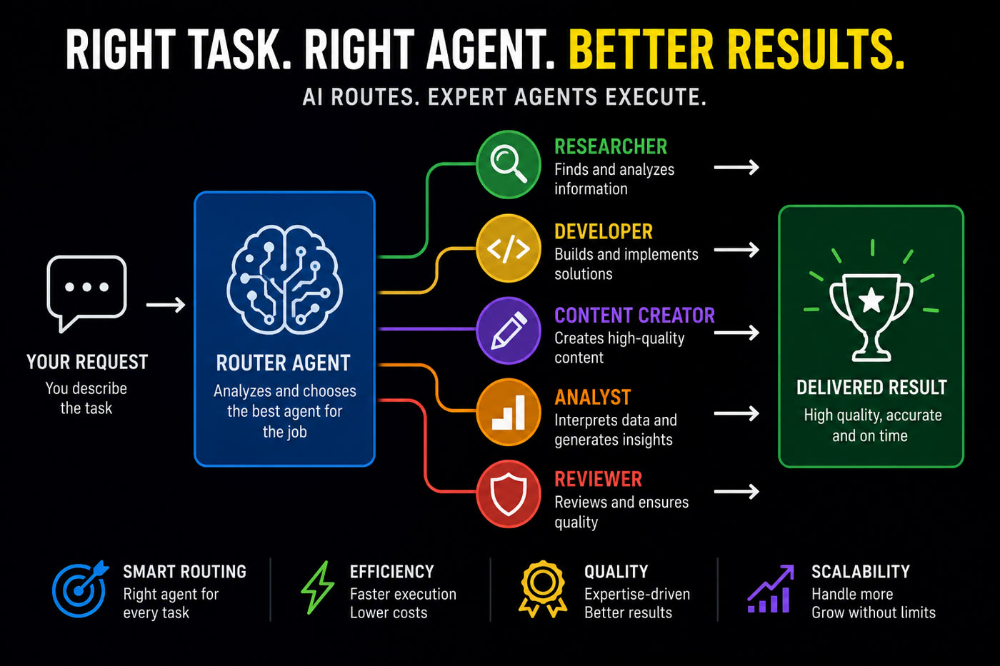
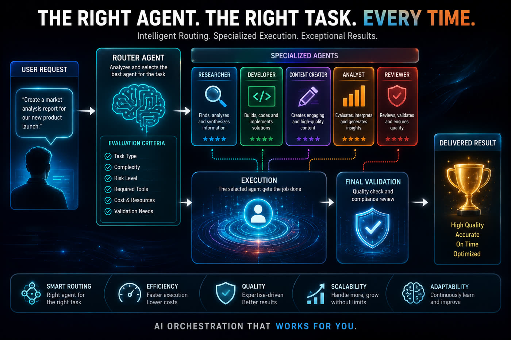

# maestro-roteador

<div align="center">
  
  <p><strong>Arckhé AI</strong></p>
</div>


Skill de **triagem de modelo e esforêƒÂ§o** para Claude Code: recebe um problema bruto e decide qual modelo (haiku / sonnet / opus / fable) e qual esforêƒÂ§o de raciocêƒÂ­nio (low ê¢â€ â€™ max) usar em cada parte do trabalho, antes de despachar subagentes ou workflows.

**Guia completo (landing + passo a passo):** https://inematds.github.io/maestro-roteador/guia/
**Tira-dêƒÂºvidas para iniciantes (analogias, FAQ e passo a passo):** [docs/guia-explicativo.md](docs/guia-explicativo.md)
**ReferêƒÂªncia de dados de esforêƒÂ§o (Opus 5.5 e GPT-6 Astra, com grêƒÂ¡ficos):** https://inematds.github.io/modelos/guia/esforco/ ê¢â‚¬â€ evidêƒÂªncia de terceiros que reforêƒÂ§a a escada; nêƒÂ£o altera o procedimento.
**English version:** [README.en.md](README.en.md) ê‚· [SKILL.en.md](skills/maestro-roteador/SKILL.en.md)

---

## Por que essa skill existe

Sem regra nenhuma, agentes colapsam qualquer tarefa em "sonnet + medium" ê¢â‚¬â€ o meio-termo genêƒÂ©rico. Isso erra nas duas direêƒÂ§êƒÂµes ao mesmo tempo:

- **Paga demais** em tarefas mecêƒÂ¢nicas (renomear 80 arquivos nêƒÂ£o precisa de sonnet, nem de medium);
- **Paga de menos** em tarefas com risco real (migraêƒÂ§êƒÂ£o de produêƒÂ§êƒÂ£o precisa de mais verificaêƒÂ§êƒÂ£o, nêƒÂ£o de "medium com cuidado") e em tarefas de gosto (copy com voz de marca precisa de repertêƒÂ³rio, que sonnet nêƒÂ£o tem).

A skill substitui o meio-termo por **duas perguntas independentes**, respondidas separadamente.

## A ideia central: dois eixos que nêƒÂ£o se convertem

| Eixo | Pergunta que ele responde | O que ele compra |
|---|---|---|
| **Modelo** | Qual nêƒÂ­vel de repertêƒÂ³rio/critêƒÂ©rio o **pior passo** da tarefa exige? | RepertêƒÂ³rio (gosto, sutileza, julgamento sem gabarito) |
| **EsforêƒÂ§o** | Quanta deliberaêƒÂ§êƒÂ£o e verificaêƒÂ§êƒÂ£o a **ambiguidade + custo do erro** pagam? | DeliberaêƒÂ§êƒÂ£o (checar o prêƒÂ³prio trabalho, comparar caminhos) |

**EsforêƒÂ§o compra deliberaêƒÂ§êƒÂ£o, nunca repertêƒÂ³rio. Modelo compra repertêƒÂ³rio, nunca verificaêƒÂ§êƒÂ£o.** êƒâ€° por isso que combinaêƒÂ§êƒÂµes "cruzadas" sêƒÂ£o legêƒÂ­timas e frequentes:

- `fable + low` ê¢â€ â€™ roteiro com voz de marca: o pior passo êƒÂ© **gosto** (eixo modelo), mas a decisêƒÂ£o êƒÂ© direta (esforêƒÂ§o baixo).
- `sonnet + high` ê¢â€ â€™ migraêƒÂ§êƒÂ£o com produêƒÂ§êƒÂ£o em risco: a capacidade exigida êƒÂ© **padrêƒÂ£o** (eixo modelo), mas o erro êƒÂ© caro ê¢â‚¬â€ o risco pede **verificaêƒÂ§êƒÂ£o**, nêƒÂ£o inteligêƒÂªncia.

Quem escolhe "sonnet+medium equilibrado" estêƒÂ¡ fugindo das duas perguntas, nêƒÂ£o respondendo êƒÂ s duas.

## O procedimento (sempre nesta ordem)

1. **Isole o pior passo.** Da tarefa inteira, qual passo mais exige critêƒÂ©rio fino?
2. **Modelo = o MENOR que resolve bem esse pior passo.**
   - MecêƒÂ¢nico com gabarito claro (renomear, extrair, formatar) ê¢â€ â€™ `haiku`
   - ImplementaêƒÂ§êƒÂ£o padrêƒÂ£o, correta-ou-errada verificêƒÂ¡vel ê¢â€ â€™ `sonnet`
   - Julgamento sem gabarito (voz de marca, arquitetura, diagnêƒÂ³stico obscuro) ê¢â€ â€™ `opus`/`fable`
3. **EsforêƒÂ§o = ambiguidade + custo do erro.**
   - SoluêƒÂ§êƒÂ£o êƒÂºnica + erro barato ê¢â€ â€™ `low`
   - Escolha entre caminhos OU erro chato de corrigir ê¢â€ â€™ `medium`
   - VêƒÂ¡rios caminhos plausêƒÂ­veis OU erro caro (produêƒÂ§êƒÂ£o, dado perdido, publicaêƒÂ§êƒÂ£o) ê¢â€ â€™ `high`+
   - **Risco nomeado = high, no mêƒÂ­nimo.** Se vocêƒÂª mesmo escreveu "produêƒÂ§êƒÂ£o em risco" na justificativa, "medium com cuidado" nêƒÂ£o existe.
   - **Escada com evidêƒÂªncia (sêƒÂ³ para erro barato):** se o erro êƒÂ© reversêƒÂ­vel e verificêƒÂ¡vel na hora, comece no menor esforêƒÂ§o plausêƒÂ­vel e **sêƒÂ³ suba com evidêƒÂªncia** de resultado insuficiente ê¢â‚¬â€ nunca "high por garantia". A escada NêƒÆ’O se aplica a risco irreversêƒÂ­vel: aêƒÂ­ a "evidêƒÂªncia de falha" seria o prêƒÂ³prio prejuêƒÂ­zo.
4. **Volume:** N itens iguais ê¢â€ â€™ teste 1 item no menor modelo; se passa, o lote inteiro vai nele.



## Tabela rêƒÂ¡pida

| Tarefa | Modelo | EsforêƒÂ§o | Por quêƒÂª |
|---|---|---|---|
| Renomear/extrair/formatar em lote | haiku | low | Gabarito claro, erro barato |
| Feature clara, refactor localizado | sonnet | medium | PadrêƒÂ£o, verificêƒÂ¡vel |
| MigraêƒÂ§êƒÂ£o de dados com produêƒÂ§êƒÂ£o em risco | sonnet | high | Capacidade padrêƒÂ£o; o risco pede verificaêƒÂ§êƒÂ£o, nêƒÂ£o inteligêƒÂªncia |
| Roteiro/copy com voz de marca | fable | low | Pior passo êƒÂ© gosto (repertêƒÂ³rio); decisêƒÂ£o êƒÂ© direta |
| Bug misterioso, decisêƒÂ£o de arquitetura | fable | high | DifêƒÂ­cil E ambêƒÂ­guo |

## Armadilhas ê¢â‚¬â€ cada uma explicada

RacionalizaêƒÂ§êƒÂµes vistas em teste real, e por que estêƒÂ£o erradas:

1. **"sonnet+medium equilibra custo e qualidade."** Meio-termo êƒÂ© fugir das duas perguntas. Responda cada eixo; o resultado quase nunca êƒÂ© o centro da matriz.
2. **"Roteiro curto nêƒÂ£o exige raciocêƒÂ­nio pesado" ê¢â€ â€™ rebaixa o modelo.** ConfusêƒÂ£o de eixos: nêƒÂ£o exigir *deliberaêƒÂ§êƒÂ£o* justifica esforêƒÂ§o low ê¢â‚¬â€ nêƒÂ£o justifica modelo menor quando o pior passo êƒÂ© critêƒÂ©rio de marca. A resposta êƒÂ© `fable+low`.
3. **"Medium êƒÂ© suficiente pra fazer com cuidado" (com produêƒÂ§êƒÂ£o em risco).** VocêƒÂª mesmo nomeou o risco. Cuidado êƒÂ© exatamente o que o esforêƒÂ§o compra ê¢â‚¬â€ risco nomeado = high.
4. **"Vou de modelo maior por garantia."** Se o pior passo estêƒÂ¡ dentro da capacidade do menor, o maior entrega o mesmo cobrando mais. Garantia se compra com esforêƒÂ§o/verificaêƒÂ§êƒÂ£o, nêƒÂ£o com modelo.
5. **"Modelo pequeno + esforêƒÂ§o max sai barato."** Pior combinaêƒÂ§êƒÂ£o possêƒÂ­vel: paga deliberaêƒÂ§êƒÂ£o pra quem nêƒÂ£o tem repertêƒÂ³rio pra usêƒÂ¡-la, e os tokens de raciocêƒÂ­nio acumulam.
6. **"Subo o esforêƒÂ§o pra sair mais bonito/caprichado."** EsforêƒÂ§o compra deliberaêƒÂ§êƒÂ£o, nêƒÂ£o gosto. Acabamento êƒÂ© eixo de **modelo** (ver "empate de gosto" abaixo). Medido em teste real com 12 nêƒÂ­veis de esforêƒÂ§o em 2 providers: de high pra max, a diferenêƒÂ§a foi um favicon ê¢â‚¬â€ por 2ê¢â‚¬â€œ5êƒâ€” os tokens.
7. **"EsforêƒÂ§o a mais nêƒÂ£o ajuda, mas tambêƒÂ©m nêƒÂ£o atrapalha."** Atrapalha ê¢â‚¬â€ e o overthinking êƒÂ© o **excesso do prêƒÂ³prio eixo esforêƒÂ§o**, nêƒÂ£o um defeito do modelo. EsforêƒÂ§o compra deliberaêƒÂ§êƒÂ£o; quando sobra deliberaêƒÂ§êƒÂ£o numa tarefa simples, o modelo re-explora caminhos jêƒÂ¡ decididos e superdimensiona a soluêƒÂ§êƒÂ£o. O resultado pode sair **pior**, nêƒÂ£o sêƒÂ³ mais caro ê¢â‚¬â€ como quem revisa tanto a prova que troca a resposta certa pela errada. Os dois erros do eixo sêƒÂ£o simêƒÂ©tricos: esforêƒÂ§o de menos em tarefa ambêƒÂ­gua erra por falta de verificaêƒÂ§êƒÂ£o; esforêƒÂ§o de mais em tarefa simples erra por ruêƒÂ­do. O esforêƒÂ§o certo êƒÂ© o **menor que cobre o risco**.

## Anti-overhead: a triagem tambêƒÂ©m tem custo

- **Tarefa mais barata que a prêƒÂ³pria triagem nêƒÂ£o recebe triagem** ê¢â‚¬â€ "corrige esse typo" vai direto no default do turno, sem YAML de despacho.
- **A triagem roda inline no turno principal, nunca num subagente** ê¢â‚¬â€ despachar um agente sêƒÂ³ pra decidir modelo/esforêƒÂ§o custa mais que a decisêƒÂ£o vale.
- **Fragmentar tambêƒÂ©m tem custo:** sêƒÂ³ despache uma parte pra subagente se o trabalho dela superar o overhead do spawn.

## Empate de gosto ê¢â€ â€™ a escolha êƒÂ© do usuêƒÂ¡rio (custo êƒâ€” qualidade)

**Erro nêƒÂ£o êƒÂ© negociêƒÂ¡vel; eficiêƒÂªncia êƒÂ©.** Quando a escolha do modelo depende sêƒÂ³ de **acabamento** (qualidade de copy, polish visual) e nêƒÂ£o de correêƒÂ§êƒÂ£o, a decisêƒÂ£o êƒÂ© de orêƒÂ§amento ê¢â‚¬â€ e orêƒÂ§amento êƒÂ© do usuêƒÂ¡rio. A triagem apresenta o par e nêƒÂ£o decide sozinha:

```yaml
opcoes:
  custo: sonnet+low        # estrutura correta, acabamento funcional
  qualidade: fable+low     # mesma estrutura, copy/polish superior
decide: usuêƒÂ¡rio
```

Sinal de empate: existe um template/skill que jêƒÂ¡ garantiu a estrutura (a correêƒÂ§êƒÂ£o vem do gabarito) e o que sobra pro modelo grande êƒÂ© sêƒÂ³ voz/acabamento. **Nunca** oferecer o par quando o risco êƒÂ© de correêƒÂ§êƒÂ£o ê¢â‚¬â€ aêƒÂ­ o modelo/esforêƒÂ§o que garante a correêƒÂ§êƒÂ£o êƒÂ© o mêƒÂ­nimo, nêƒÂ£o uma escolha.

## Cache: o custo escondido da troca de modelo

O prompt cache da Anthropic êƒÂ© **por modelo** e depende de prefixo idêƒÂªntico do contexto (`tools ê¢â€ â€™ system ê¢â€ â€™ messages`). Ler do cache custa ~0,1êƒâ€” o preêƒÂ§o de entrada; gravar custa 1,25êƒâ€” (TTL 5 min) ou 2êƒâ€” (TTL 1h). Perder o cache de um contexto de 100k tokens torna a prêƒÂ³xima entrada **~12,5êƒâ€” mais cara**. TrêƒÂªs regras na triagem:

1. **Troca de `/model` do turno principal sêƒÂ³ em fronteira de trabalho** (fim de fase, handoff) ê¢â‚¬â€ nunca no meio de um bloco. Em contexto grande, a troca pode custar mais que a economia do modelo menor. NêƒÂ£o alterne `opus ê¢â€ â€™ sonnet ê¢â€ â€™ opus` dentro do mesmo bloco.
2. **Subagente NêƒÆ’O paga esse custo.** Cada Agent/Workflow tem contexto prêƒÂ³prio: rotear uma parte pra um modelo menor via subagente nêƒÂ£o toca o cache principal. êƒâ€° o caminho preferido pra aplicar a matriz.
3. **Nunca keepalive artificial** ("ainda estêƒÂ¡ aêƒÂ­?") pra segurar o cache ê¢â‚¬â€ o Claude Code gerencia o cache sozinho e o ping custa mais do que salva. Pausa longa? Handoff enxuto e deixe expirar.

Rotina que preserva cache: blocos contêƒÂ­nuos de trabalho, comeêƒÂ§o do contexto estêƒÂ¡vel (nêƒÂ£o ligar/desligar ferramentas e MCPs no meio do bloco), tarefas relacionadas concentradas na mesma sessêƒÂ£o.

## Harness > esforêƒÂ§o: onde o resultado nasce

O modelo êƒÂ© um cêƒÂ©rebro num pote ê¢â‚¬â€ ferramentas, arquivos, terminal, skills e instruêƒÂ§êƒÂµes (o **harness**) sêƒÂ£o os braêƒÂ§os dele. Num teste real com a mesma tarefa em 12 nêƒÂ­veis de esforêƒÂ§o e 2 providers, os resultados funcionais foram quase idêƒÂªnticos; os nêƒÂ­veis altos adicionaram diferenêƒÂ§as estêƒÂ©ticas (favicon, sombras, um donut chart) por 2ê¢â‚¬â€œ5êƒâ€” os tokens.

A liêƒÂ§êƒÂ£o: **uma spec clara em low entrega o que o esforêƒÂ§o max tenta adivinhar.** Antes de subir o esforêƒÂ§o, melhore o prompt, a especificaêƒÂ§êƒÂ£o do "pronto" e as ferramentas disponêƒÂ­veis.



## Formato de saêƒÂ­da (plano de despacho)

```yaml
tarefa: <resumo>
partes:
  - o_que: <subtarefa>
    pior_passo: <qual e por quêƒÂª>
    modelo: haiku|sonnet|opus|fable
    esforco: low|medium|high|xhigh|max
    risco: <custo do erro em 1 linha>
turno_principal: <recomendaêƒÂ§êƒÂ£o de /model se valer trocar ê¢â‚¬â€ a troca êƒÂ© do usuêƒÂ¡rio>
```

**Limite:** para subagentes/workflows a decisêƒÂ£o êƒÂ© automêƒÂ¡tica (parêƒÂ¢metros `model`/`effort` das chamadas Agent/Workflow); para o modelo da conversa principal a skill apenas recomenda ê¢â‚¬â€ a troca êƒÂ© do usuêƒÂ¡rio via `/model`, de preferêƒÂªncia em fronteira de trabalho (ver Cache).

## ValidaêƒÂ§êƒÂ£o (TDD de skill)

A skill foi escrita contra um baseline medido: sem ela, agentes colapsam qualquer tarefa em "sonnet + medium". Com ela, os trêƒÂªs cenêƒÂ¡rios de teste foram para o canto certo da matriz:

| CenêƒÂ¡rio | Sem skill | Com skill |
|---|---|---|
| Renomear 80 arquivos em lote | sonnet + medium | haiku + low |
| Roteiro com voz de marca | sonnet + medium | fable + low |
| MigraêƒÂ§êƒÂ£o de dados com produêƒÂ§êƒÂ£o em risco | sonnet + medium | sonnet + high |

## Estrutura

```
skills/
  maestro-roteador/
    SKILL.md       # a skill: princêƒÂ­pio, procedimento, tabela, armadilhas, cache, saêƒÂ­da
    SKILL.en.md    # traduêƒÂ§êƒÂ£o em inglêƒÂªs da skill
guia/
  index.html    # landing + guia de uso (GitHub Pages)
  assets/       # imagens do guia
docs/
  guia-explicativo.md  # tira-dêƒÂºvidas educativo: analogias, FAQ, passo a passo
```

## InstalaêƒÂ§êƒÂ£o

```bash
git clone https://github.com/inematds/maestro-roteador.git
ln -sfn "$(pwd)/maestro-roteador/skills/maestro-roteador" ~/.claude/skills/maestro-roteador
```

Ou copie a pasta `skills/maestro-roteador/` para `~/.claude/skills/` (skills de usuêƒÂ¡rio) ou `.claude/skills/` de um projeto.

## Uso

PeêƒÂ§a a triagem diretamente ê¢â‚¬â€ "faz a triagem disso", "qual modelo e esforêƒÂ§o pra isso?" ê¢â‚¬â€ ou apenas peêƒÂ§a o trabalho: ao despachar subagentes/workflows, o agente aplica a matriz e distribui cada parte com `model` e `effort` adequados.

## Changelog

- **v1.3.3** ê¢â‚¬â€ Fable 5.2: Opus 5.5 medium como ponto de partida, escada lowê¢â€ â€™high sêƒÂ³ no que falhar, dividir sêƒÂ³ nos 2 casos medidos, ajudantes com `model`/`effort` fixos, Explore no Haiku, Fable como revisor (base: documento oficial da Anthropic + mediêƒÂ§êƒÂµes do [fable-barato](https://github.com/inematds/fable-barato)); campo `dividir` no plano de despacho.
- **v1.2.3** ê¢â‚¬â€ versêƒÂµes em inglêƒÂªs da skill (SKILL.en.md) e do README (README.en.md).
- **v1.2.2** ê¢â‚¬â€ armadilha do overthinking explicitada (excesso do prêƒÂ³prio eixo esforêƒÂ§o; o esforêƒÂ§o certo êƒÂ© o menor que cobre o risco) + docs/guia-explicativo.md (tira-dêƒÂºvidas educativo com analogias, FAQ e passo a passo).
- **v1.2.1** ê¢â‚¬â€ escada com evidêƒÂªncia (erro barato comeêƒÂ§a em low e sobe sêƒÂ³ com evidêƒÂªncia), 2 armadilhas novas (estêƒÂ©tica nêƒÂ£o êƒÂ© esforêƒÂ§o; overthinking piora), seêƒÂ§êƒÂ£o de cache (troca sêƒÂ³ em fronteira, subagente grêƒÂ¡tis em cache, sem keepalive); guia ganha hero com imagem + seêƒÂ§êƒÂµes Cache e Harness; README educativo completo.
- **v1.1.1** ê¢â‚¬â€ guia/index.html (landing+guia padrêƒÂ£o INEMA) + regra anti-overhead na skill.
- **v1.1.0** ê¢â‚¬â€ empate de gosto oferece escolha custo (sonnet+low) êƒâ€” qualidade (fable+low).
- **v1.0.0** ê¢â‚¬â€ skill maestro-roteador: triagem de modelo e esforêƒÂ§o (matriz de dois eixos).

## LicenêƒÂ§a

MIT ê¢â‚¬â€ projeto de pesquisa/educaêƒÂ§êƒÂ£o INEMA.

---

<div align="center">
  
  <p><strong>Arckhé AI</strong></p>
</div>